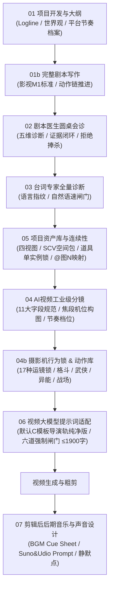

# anti提示词：一线导演剧本创作与AI视频分镜工作流

[](LICENSE)
[](SKILL.md)
[](anti提示词.md)

> **anti提示词** 是将 34 个专科模块、超过 1.2 万行视听工程规范深度蒸馏而成的工业级全流程 AI 视频创作体系。
> 它融合了院线电影剧作法、爆款短剧完播算法、分镜工业视听语言与主流视频大模型（Seedance 2.0 / 可灵 Kling / Sora / 豆包视频 / Veo）的底层生成机理，专为高质量短剧、商业宣传片、动画漫剧、影视级分镜及视频大模型提示词开发量身定制。

---

## 🌟 核心升级与蒸馏特性

| 痛点场景 | 传统泛化 AI 提示词 | **anti提示词** 工业级解决方案 |
|---|---|---|
| **模型理解能力** | 混入平台参数与管理套话（如“9:16 / 10秒 / 接下一段”） | **参数外置，画面内化**：纯净提示词只写物理可见事实、微动作与真实光影 |
| **视频生成长度** | 提示词动辄 3000 字导致大模型忽略后半截甚至报错 | **1900 字安全线闸门**：默认采用 **C 导演轨纯净版（一行四段）**，轻松容纳 4-7 镜 |
| **画面连续性** | 前后镜头人物服装换脸、道具凭空复制或乱变 | **资产映射与道具单实例锁**：前置 `@图片N` 严格映射，单段 $\le 9$ 张图，锁死朝向与数量 |
| **镜头节奏感** | 镜头拖沓、慢镜头无意义空转，短视频完播率崩塌 | **四档节奏矩阵贯穿全链路**：强制执行“呼吸镜头合法性”，慢镜头必须承担视听功能 |
| **台词与口型** | 塞入长台词导致视频模型口型崩坏或机械超速 | **台词自然语速与补偿模型**：严格按 3-6 字/秒预审台词时长，超限强制拆分或精修 |
| **后期配乐** | 提示词中混写 BGM 导致模型生成杂音破坏现场声 | **声音职责彻底解耦**：06 仅控现场音与原声，07 后期统一输出 BGM Cue Sheet 与 AI 音乐 Prompt |

---

## 🏗️ 全链路工作流架构



---

## 📁 仓库结构

```text
anti-prompt/
├── README.md                           # 本项目说明文档与工作流总览
├── anti提示词.md                       # 核心交付物：全量蒸馏提示词（可直接复制投喂）
├── SKILL.md                            # Antigravity / Claude Code / Codex Skill 规范入口
├── examples/
│   └── seedance_storyboard_example.md  # 工业级端到端实战范例（分镜到成片提示词）
├── scripts/
│   └── check_prompt_gates.py           # 离线验证脚本：自动核验六道强制闸门与台词语速
└── .gitignore                          # Git 忽略配置
```

---

## 🚀 快速上手与调用指南

### 1. 本地安装为 Skill（Antigravity / Codex / Claude Code）

克隆本仓库到你的技能目录：

```bash
git clone https://github.com/2395300049-sys/anti-prompt.git "${CODEX_HOME:-$HOME/.codex}/skills/anti-prompt"
```

或者在 Antigravity 自定义技能目录中直接引入该文件夹。

### 2. 作为独立提示词直接使用（ChatGPT / Claude / Kimi / 豆包）

直接打开 [`anti提示词.md`](anti提示词.md)，复制全文作为 System Prompt 或直接粘贴至对话框开头，随后输入你的任务：

```text
使用 anti提示词，帮我把以下一句话灵感开发成短剧大纲和前 3 场戏：
“落魄老刑警在翻修老宅地下室时，挖出了一部还在响铃的 20 年前失踪案被害人手机。”
```

### 3. 常见阶段调用指令

- **从零立项**：`使用 anti提示词，从零开发题材为[悬疑/都市/科幻]的短剧大纲，设定目标平台为抖音/红果。`
- **剧本会诊**：`使用 anti提示词，会诊这份剧本，重点诊断前 3 秒留人和集尾钩子的有效性。`
- **台词精修**：`使用 anti提示词，逐句诊断这段对白，剔除书面语，核验自然语速是否能在 8 秒内说完。`
- **建立资产**：`使用 anti提示词，建立本剧核心角色与关键道具的资产映射表，生成角色四视图出图提示词。`
- **AI 视频分镜**：`使用 anti提示词，把剧本第 1 场转为 11 维工业级分镜，自动标记节奏档位。`
- **生成视频提示词**：`使用 anti提示词，将分镜转为 Seedance 2.0 提示词包，默认使用 C 导演轨纯净版。`
- **后期声音设计**：`使用 anti提示词，根据这份 90 秒粗剪时间轴，输出全片 BGM Cue Sheet 与 AI 音乐 Prompt。`

---

## 📐 核心输出模板规格

### 模板 C：导演轨纯净版（06 默认成品格式）

纯净代码框内采用 **“一行四段”**（`序号｜功能标签｜镜头/焦点｜动作/台词｜光影/转接`），既保证全维度视听精控，又严控字数：

```text
特别注意：全程轻微手持呼吸感，主体居中稳定；严格按镜头轨重新构图，不继承多余背景。
素材锚定：使用 @图片1 作为地下室环境参考；使用 @图片2 作为锈蚀手机道具参考。将 @图片3 中的白发夹克中年男性定义为 <老刑警>。
场景锚定：内景·潮湿老宅地下室·深夜，头顶摇晃单颗暖黄钨丝灯，空气浮尘明显，压抑窒息基调。

镜头轨：
1｜悬念开场｜50mm中焦｜f/2.8中景深｜视线眼平俯拍中景｜摄影机缓推半步｜<老刑警> 蹲在泥坑前，双手沾满泥垢，缓缓伸向泥土深处，屏息凝神无对白｜头顶钨丝灯自上而下投下高反差顶光，眼窝深陷阴影，泥坑高光反光｜接手指触碰硬物
2｜异变骤起｜85mm长焦｜f/1.8浅景深｜近景焦点死锁在沾泥手背｜摄影机微晃定格｜指尖拨开泥土露出生锈手机外壳，手机屏幕突然剧烈闪烁绿光并震动，<老刑警> 瞳孔骤缩抽手半寸｜幽绿屏幕荧光瞬间照亮其右手下颌，与暖黄顶光形成冷暖对冲｜接手机屏幕特写
3｜段末钩子｜微距特写｜大景深清晰记录｜极低机位平视特写｜摄影机完全静止｜屏幕显现无来电显示的跳动倒计时，手机听筒传出微弱刺耳的电流盲音，无人物对白｜绿光频闪明暗交替，手机背面死锁朝向泥土屏幕朝上｜段末绿光死锁定格

声音轨：只生成环境声、对白原声和同步音效，不生成 BGM；环境声为地下室滴水与水管低频回响，音效为泥土摩擦声、手机机械高频震动音与刺耳电流杂音。
硬锁：保持 <老刑警> 苍老面容与皮夹克一致；PR001 生锈手机全段只此一台，屏幕朝上背面朝泥土，严禁乱码文字与多余路人；严禁整体提亮。
段末状态：老刑警保持右手悬停半寸警惕姿态，手机屏幕持续幽绿频闪，极低机位微距视角定格。
```

---

## 🛠️ 离线自检工具（Check Gates）

本项目附带纯 Python 标准库编写的六道强制出门闸门检查器，无需第三方依赖：

```bash
# 验证示例分镜文件
python3 scripts/check_prompt_gates.py examples/seedance_storyboard_example.md
```

检查器会自动核验：
1. **字数闸门**：代码框内纯净提示词是否 $\le 1900$ 字（安全线）及 $\le 2000$ 字（极限）。
2. **图片上限**：单单元引用 `@图片N` 是否 $\le 9$ 张。
3. **管理词拦截**：是否误将“接下一段 / 承接上一大分镜 / 9:16 / 无则删除”等非画面管理词写入代码框。
4. **台词时长预审**：基于中文字数与标点符号预审能否自然说完。

---

## 📜 蒸馏原则与知识产权声明

本项目是基于公开行业导演视听知识库及短剧工业创作实践深度整理提炼的原创方法论架构。所有编号机制、提示词转译模板、摄影机行为锁体系及自检闸门均为工程化标准化设计。

---

## 📄 License

[MIT License](LICENSE)
